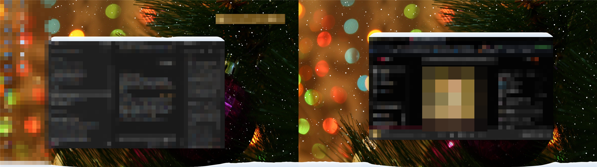
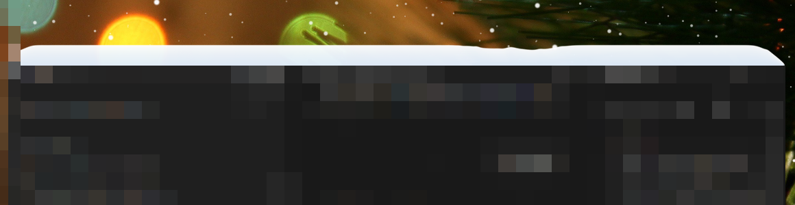

# Snowhush pour Windows

Il neige sur ton bureau. La neige tombe, se pose sur le haut des fenêtres et en
bas de l'écran, s'écarte sous le curseur, et tombe quand une fenêtre bouge ou se ferme.

Réécriture légère pour Windows 10 et 11, inspirée de [Snowhush](https://github.com/mbezruchko/Snowhush).





*Sur les captures, le contenu des fenêtres est volontairement pixelisé.*

## Installation

1. Télécharge **[setup.msi](https://github.com/0x80070006/snowhush-windows/releases/latest/download/setup.msi)** depuis la dernière release.
2. Lance-le : l'installation se fait pour ton utilisateur, sans droits administrateur.
3. La neige démarre. Une icône flocon apparaît près de l'horloge pour accéder aux réglages.

Pour désinstaller : Paramètres → Applications → Snowhush.

> L'installateur n'est pas signé numériquement. Windows SmartScreen peut afficher un avertissement :
> clique sur « Informations complémentaires » puis « Exécuter quand même ».

## Ce qu'il fait

- Flocons sur **3 plans de profondeur** : poudre lointaine, flocons principaux et gros flocons flous au premier plan.
- Vent doux avec des **rafales** qui balaient l'écran, et flottement naturel des flocons.
- Les flocons **se posent** sur le haut des fenêtres visibles et en bas de l'écran. Les tas s'éboulent en pente naturelle, avec un bord lisse et de petits reflets.
- Le **curseur** écarte les flocons, creuse les tas et projette de la poudre.
- Quand on **déplace, ferme ou réduit** une fenêtre, sa neige tombe et éclate à l'impact.
- La neige **fond** lentement (désactivable).
- Gère **plusieurs écrans** et le DPI. La fenêtre de neige laisse passer les clics.
- **Invisible dans les captures et le partage d'écran** par défaut.

## Ressources

- Rendu GPU : Direct2D *sprite batch* dans une swapchain DirectComposition, un seul appel de dessin par image.
- La fenêtre de neige laisse passer les clics et ne prend jamais le focus.
- Environ 3 à 7 % d'un cœur CPU à 60 i/s, environ 13 Mo de RAM, un exécutable d'environ 380 Ko sans dépendance.
- **0 % CPU** quand la neige est en pause, quand la session est verrouillée, quand l'écran est éteint, pendant la veille ou quand une application est en plein écran.
- 30 i/s automatiquement sur batterie ou en mode économie d'énergie.
- Le nombre de particules (6000) et le nombre de fenêtres suivies (48) sont plafonnés.

## Menu (icône flocon dans la zone de notification)

| Entrée | Effet |
|---|---|
| Mettre en pause / Reprendre | Arrête ou relance la neige |
| Intensité | Légère, Moyenne, Forte, Tempête |
| Opacité | De 25 à 100 % |
| Accumuler sur | Sol et/ou fenêtres |
| Déblayer la neige | Vide tous les tas |
| Réglages ▸ Fonte de la neige | Les tas fondent doucement |
| Réglages ▸ Neige sous la barre des tâches | Le tas se forme en bas de l'écran (utile avec une barre des tâches transparente) |
| Réglages ▸ Afficher par-dessus le plein écran | Garde la neige affichée au-dessus des jeux et des vidéos |
| Réglages ▸ Visible dans les captures | Par défaut, la neige n'apparaît pas dans les captures d'écran ni dans les partages d'écran |
| Réglages ▸ 30 / 60 / max i/s | Cadence d'affichage |
| Réglages ▸ Lancer au démarrage | Ajoute l'application à la clé `HKCU\…\Run` |

## Compilation

Il faut Rust (toolchain `stable-x86_64-pc-windows-gnu` ou `-msvc`).

```bash
cargo build --release
```

Le binaire est créé dans `target\release\snowhush.exe`. Lance les tests avec `cargo test --release`.

> Les versions de `windows-result` et `windows-strings` sont figées dans `Cargo.toml`. Les versions
> plus récentes passent par `windows-link` (raw-dylib), qui a besoin de `dlltool` et `as` avec la toolchain GNU.

## Installateur (setup.msi)

```bash
powershell -ExecutionPolicy Bypass -File .\build-msi.ps1
```

Le script produit `dist\setup.msi`. Il a besoin de WiX 3.14 dans `tools\wix` (`wix314-binaries.zip`, à télécharger depuis github.com/wixtoolset/wix3).

- Installation **par utilisateur** dans `%LOCALAPPDATA%\Programs\Snowhush` : pas de droits administrateur, pas d'UAC.
- Ajoute un raccourci dans le menu Démarrer et le lancement à l'ouverture de session, puis démarre la neige à la fin de l'installation.
- Une version plus récente remplace l'ancienne. L'app en cours est fermée proprement avant une mise à jour ou une désinstallation.
- Installation silencieuse : `msiexec /i setup.msi /qn`.

## Fichiers

- Réglages : `%APPDATA%\SnowhushWin\settings.ini`
- Journal : `%LOCALAPPDATA%\SnowhushWin\snowhush.log` (256 Ko maximum, avec rotation)

## Architecture

| Fichier | Rôle |
|---|---|
| `src/sim.rs` | Physique pure et testée : flocons, vent, tas, éboulement, fonte, curseur, chute des tas |
| `src/tracker.rs` | Bords supérieurs visibles des fenêtres (ordre z, occlusion) |
| `src/sprites.rs` | Liste de sprites d'une image : 3 plans de profondeur, tas lissés avec un bord adouci, reflets |
| `src/render.rs` | D3D11, Direct2D et DirectComposition ; recréation automatique si le périphérique est perdu |
| `src/app.rs` | Fenêtres, icône de notification, menu, pauses automatiques, multi-écran et DPI |
| `src/main.rs` | Instance unique, boucle synchronisée sur la swapchain (*frame latency waitable*) |

## Robustesse

- Périphérique GPU perdu (mise à jour du pilote, sortie de veille) : le rendu est recréé, avec de nouvelles tentatives espacées. Si aucun GPU n'est disponible, le rendu bascule sur WARP.
- Changement d'écran, de résolution, de DPI ou de barre des tâches : la géométrie est recalculée après 600 ms.
- Redémarrage d'Explorer : l'icône de notification est remise.
- Pas de panique en cas de ré-entrance des messages Windows (`try_borrow_mut`). Une éventuelle panique est écrite dans le journal.

## Licence

[MIT](LICENSE). Projet indépendant, réécrit de zéro, qui reprend l'idée de [Snowhush](https://github.com/mbezruchko/Snowhush) de mbezruchko (macOS, Windows, Linux).
